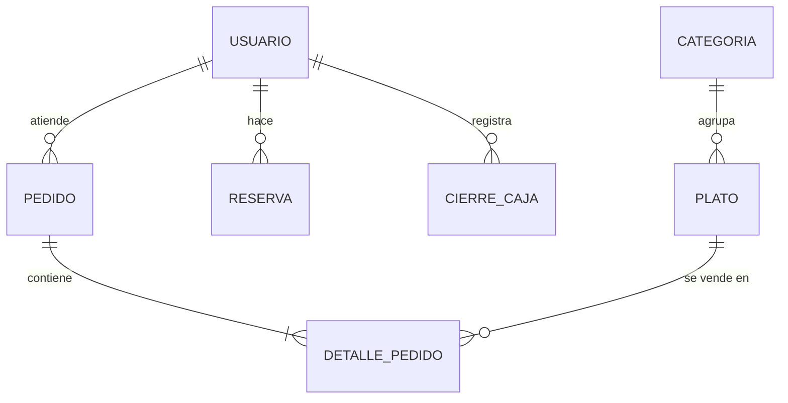

<div align="center">


# SIGR — Sistema Integral de Gestión de Restaurante

Aplicación web en Flask para gestionar menú, pedidos, reservas y caja de un restaurante.

[](https://www.python.org/)
[](https://flask.palletsprojects.com/)
[](https://www.sqlite.org/)
[](LICENSE.txt)
[](https://github.com/JFOZ1010/sigr/actions/workflows/ci.yml)

</div>

---

## 📑 Tabla de contenidos

- [📖 Descripción](#-descripción)
- [✨ Características](#-características)
- [🧰 Stack tecnológico](#-stack-tecnológico)
- [👥 Roles y permisos](#-roles-y-permisos)
- [🗂️ Estructura del proyecto](#️-estructura-del-proyecto)
- [🚀 Instalación](#-instalación)
- [🔑 Credenciales demo](#-credenciales-demo)
- [🛣️ Rutas principales](#️-rutas-principales)
- [🗄️ Modelo de datos](#️-modelo-de-datos)
- [🧪 Pruebas](#-pruebas)
- [🔀 Flujo de trabajo](#-flujo-de-trabajo)
- [📏 Convenciones de código](#-convenciones-de-código)
- [📚 Documentación asociada](#-documentación-asociada)
- [📄 Licencia](#-licencia)
- [👤 Autor](#-autor)

## 📖 Descripción

SIGR es una línea base pequeña y funcional para un restaurante: el administrador arma el menú y cierra la caja, el mesero toma pedidos y los avanza por sus estados, y el cliente reserva mesa. Se desarrolló como proyecto individual de **Gestión de la Configuración de Software** (Tecnológico de Oriente), por lo que también cuida el control de versiones, las pruebas automáticas y la documentación.

## ✨ Características

| Módulo | Qué permite |
|---|---|
| 🔐 **Autenticación** | Registro de clientes, inicio/cierre de sesión, contraseñas con hash y rutas protegidas por rol |
| 🍝 **Menú digital** | Menú público agrupado por categoría; el administrador gestiona categorías y platos (un plato ya vendido solo se marca como no disponible) |
| 🧾 **Pedidos** | Pedidos por mesa (1–10), estados `pendiente → en_preparacion → listo → entregado → pagado` y tabla que se actualiza sola cada 5 s |
| 📅 **Reservas** | Reservas por fecha, hora y mesa, sin fechas pasadas ni choques; cancelación por el dueño o el administrador |
| 💰 **Caja** | Reporte diario (total, número de pedidos y cantidad por plato) y cierre de caja único por fecha |

## 🧰 Stack tecnológico

- **Python 3.12** · **Flask 3** · **Flask-SQLAlchemy** · **Flask-Login**
- **SQLite** (archivo `instance/sigr.db`)
- **Jinja2** + **Bootstrap 5** (por CDN); JavaScript solo para el refresco de pedidos
- **pytest** para las pruebas y **GitHub Actions** para la integración continua

## 👥 Roles y permisos

| Acción | Cliente | Mesero | Administrador |
|---|:---:|:---:|:---:|
| Ver menú | ✅ | ✅ | ✅ |
| Gestionar categorías y platos | ❌ | ❌ | ✅ |
| Crear y avanzar pedidos | ❌ | ✅ | ✅ |
| Crear reservas | ✅ | ❌ | ❌ |
| Ver reservas | solo las suyas | todas | todas |
| Cancelar reservas | las suyas | ❌ | todas |
| Reporte y cierre de caja | ❌ | ❌ | ✅ |

El registro público siempre crea usuarios `cliente`. Sin sesión se redirige al login; con un rol sin permiso la respuesta es 403.

## 🗂️ Estructura del proyecto

La aplicación usa el patrón **application factory** (`create_app`) y un **blueprint por módulo**; cada blueprint agrupa sus rutas bajo un prefijo (`/auth`, `/menu`, `/pedidos`, `/reservas`, `/caja`).

```
.
├── app/                    # Paquete de la aplicación
│   ├── __init__.py         # create_app(testing=False): configura Flask, db, login y registra los blueprints
│   ├── models.py           # Modelos SQLAlchemy (Usuario, Categoria, Plato, Pedido, DetallePedido, Reserva, CierreCaja)
│   ├── auth.py             # Blueprint /auth: registro, login, logout y decorador rol_requerido
│   ├── menu.py             # Blueprint /menu: menú público y CRUD de categorías/platos
│   ├── pedidos.py          # Blueprint /pedidos: pedidos, cambio de estado y API JSON
│   ├── reservas.py         # Blueprint /reservas: reservas y cancelación
│   ├── caja.py             # Blueprint /caja: reporte diario y cierre
│   ├── templates/          # Plantillas Jinja2: base.html y una carpeta por módulo
│   └── static/             # estilos.css y pedidos.js (polling cada 5 s)
├── tests/                  # conftest.py (fixtures) y un archivo de pruebas por módulo
├── docs/
│   ├── base_datos.md       # Tablas y diagrama entidad-relación
│   ├── manual_despliegue.md# Ejecución en macOS, Linux y Windows
│   └── img/logo.svg        # Logo del proyecto
├── .github/workflows/ci.yml# Integración continua
├── seed.py                 # Crea tablas y datos de demostración (idempotente)
├── run.py                  # Punto de entrada: expone `app`
├── requirements.txt        # Dependencias fijadas
├── CHANGELOG.md            # Historial de versiones
└── LICENSE.txt             # Licencia MIT
```

## 🚀 Instalación

```bash
# 1. Clonar
git clone https://github.com/JFOZ1010/sigr.git
cd sigr

# 2. Crear y activar el entorno virtual (Python 3.10+)
python -m venv venv
source venv/bin/activate        # Windows: venv\Scripts\activate

# 3. Instalar dependencias
pip install -r requirements.txt

# 4. Crear la base y cargar datos de demo
python seed.py

# 5. Ejecutar
flask --app run run
```

La aplicación queda en <http://127.0.0.1:5000>. Más detalles en el [manual de despliegue](docs/manual_despliegue.md).

## 🔑 Credenciales demo

| Rol | Correo | Contraseña |
|---|---|---|
| Administrador | `admin@sigr.local` | `Admin123!` |
| Mesero | `mesero@sigr.local` | `Mesero123!` |
| Cliente | `cliente@sigr.local` | `Cliente123!` |

> ⚠️ Son datos de demostración, **solo para desarrollo**. No los uses en un entorno real.

## 🛣️ Rutas principales

| Ruta | Método | Acceso | Descripción |
|---|---|---|---|
| `/auth/registro` | GET, POST | público | Registro de cliente |
| `/auth/login` · `/auth/logout` | GET, POST · GET | público | Sesión |
| `/menu/` | GET | público | Menú por categoría |
| `/menu/categorias` (+ `nueva`, `<id>/editar`, `<id>/eliminar`) | GET, POST | administrador | CRUD de categorías |
| `/menu/platos/nuevo` · `<id>/editar` · `<id>/eliminar` | GET, POST | administrador | CRUD de platos |
| `/pedidos/` | GET | mesero, admin | Pedidos no pagados |
| `/pedidos/nuevo` | GET, POST | mesero, admin | Crear pedido |
| `/pedidos/<id>/estado` | POST | mesero, admin | Avanzar estado (400 si es inválido) |
| `/pedidos/api/activos` | GET | mesero, admin | JSON `[{id, mesa, estado, total}]` |
| `/reservas/` | GET | autenticado | Lista de reservas |
| `/reservas/nueva` | GET, POST | cliente | Crear reserva |
| `/reservas/<id>/cancelar` | POST | dueño, admin | Cancelar reserva |
| `/caja/reporte?fecha=AAAA-MM-DD` | GET | administrador | Reporte diario |
| `/caja/cierre` | GET, POST | administrador | Cierre de caja |

## 🗄️ Modelo de datos



El detalle de columnas está en [docs/base_datos.md](docs/base_datos.md).

## 🧪 Pruebas

```bash
pytest -v
```

Son **20 pruebas** con SQLite en memoria: auth (4), menú (5), pedidos (5), reservas (3), caja (2) e integración (1).

## 🔀 Flujo de trabajo

- **Ramas:** `main` estable y una rama por tema (`feature/…`, `ci/…`, `docs/…`), fusionadas con `git merge --no-ff` después de pasar las pruebas.
- **Commits:** [Conventional Commits](https://www.conventionalcommits.org/es/) en español, p. ej. `feat(pedidos): …`, `test(caja): …`, `docs: …`.
- **Versionado:** [semántico](https://semver.org/lang/es/) (`MAYOR.MENOR.PARCHE`).
- **Línea base:** etiqueta `v1.0.0-linea-base`.

## 📏 Convenciones de código

- **PEP 8**: 4 espacios de indentación y líneas razonablemente cortas.
- **Nombres:** `snake_case` para funciones y variables, `PascalCase` para clases, constantes en `MAYÚSCULAS`. Nombres de dominio en español (`pedido`, `plato`, `reserva`).
- **Estructura:** un blueprint por módulo con las plantillas en `templates/<módulo>/`; los modelos van en `models.py`; la lógica se mantiene dentro de las vistas mientras sea simple.
- Textos de interfaz, comentarios, commits y documentación en español.

## 📚 Documentación asociada

- [Modelo de datos](docs/base_datos.md)
- [Manual de despliegue](docs/manual_despliegue.md)
- [Changelog](CHANGELOG.md)

## 📄 Licencia

Distribuido bajo licencia **MIT**. Consulta [LICENSE.txt](LICENSE.txt).

## 👤 Autor

**Juan Felipe Osorio Zapata** — [github.com/JFOZ1010](https://github.com/JFOZ1010)
