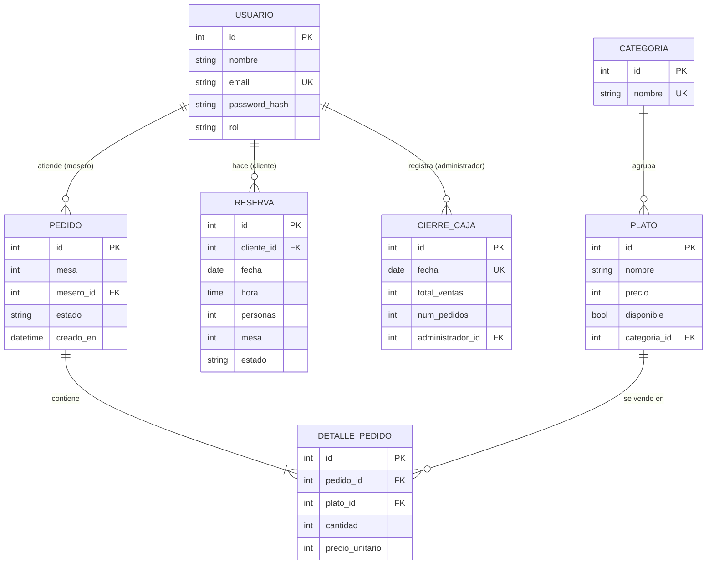

# Base de datos

Motor: **SQLite** (`instance/sigr.db`). Las tablas se crean con SQLAlchemy (`db.create_all()`) a partir de `app/models.py`. Los nombres de tabla son los que genera Flask-SQLAlchemy (clase en minúsculas).

## Diagrama

## Tablas

### `usuario`
| Columna | Tipo | Notas |
|---|---|---|
| id | Integer | PK |
| nombre | String(100) | obligatorio |
| email | String(120) | único, obligatorio |
| password_hash | String(256) | hash de `werkzeug.security` |
| rol | String(20) | `cliente`, `mesero` o `administrador` |

### `categoria`
| Columna | Tipo | Notas |
|---|---|---|
| id | Integer | PK |
| nombre | String(80) | único |

Relación: una categoría tiene muchos `plato`. No se puede eliminar si tiene platos.

### `plato`
| Columna | Tipo | Notas |
|---|---|---|
| id | Integer | PK |
| nombre | String(100) | obligatorio |
| precio | Integer | pesos COP |
| disponible | Boolean | por defecto `True` |
| categoria_id | Integer | FK → `categoria.id` |

### `pedido`
| Columna | Tipo | Notas |
|---|---|---|
| id | Integer | PK |
| mesa | Integer | 1 a 10 |
| mesero_id | Integer | FK → `usuario.id` |
| estado | String(20) | `pendiente → en_preparacion → listo → entregado → pagado` |
| creado_en | DateTime | hora local al crear |

`Pedido.total` no es una columna: es una propiedad que suma `cantidad × precio_unitario` de sus detalles.

### `detalle_pedido`
| Columna | Tipo | Notas |
|---|---|---|
| id | Integer | PK |
| pedido_id | Integer | FK → `pedido.id` (se borra en cascada con el pedido) |
| plato_id | Integer | FK → `plato.id` |
| cantidad | Integer | mínimo 1 |
| precio_unitario | Integer | copia del precio del plato al crear el pedido |

### `reserva`
| Columna | Tipo | Notas |
|---|---|---|
| id | Integer | PK |
| cliente_id | Integer | FK → `usuario.id` |
| fecha | Date | no puede ser pasada |
| hora | Time | |
| personas | Integer | mínimo 1 |
| mesa | Integer | 1 a 10 |
| estado | String(20) | `activa` o `cancelada` |

Regla: no puede haber dos reservas `activa` con la misma mesa, fecha y hora.

### `cierre_caja`
| Columna | Tipo | Notas |
|---|---|---|
| id | Integer | PK |
| fecha | Date | único (un cierre por fecha) |
| total_ventas | Integer | suma de pedidos `pagado` de ese día |
| num_pedidos | Integer | |
| administrador_id | Integer | FK → `usuario.id` |
